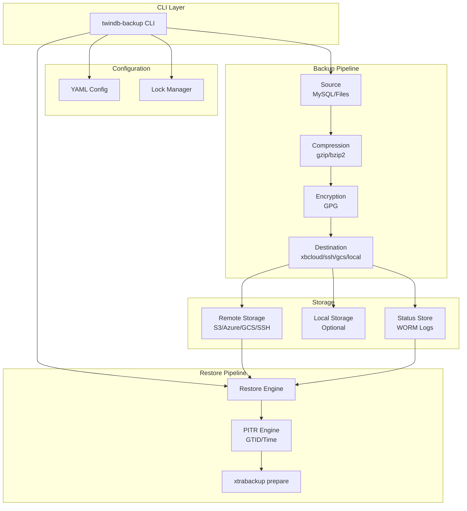
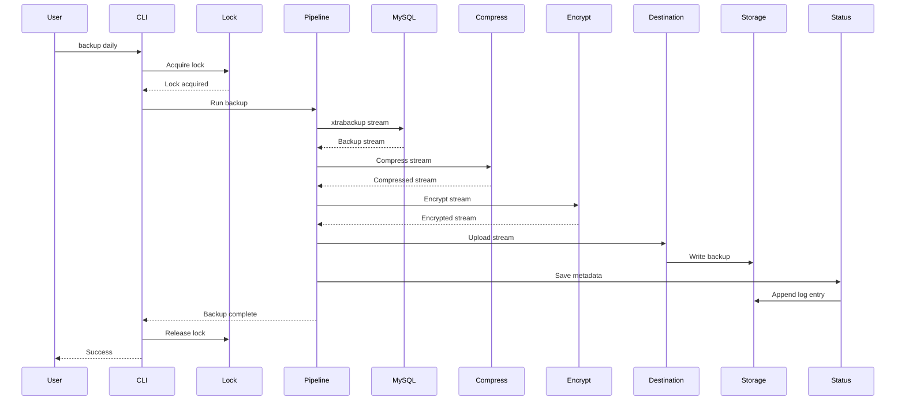
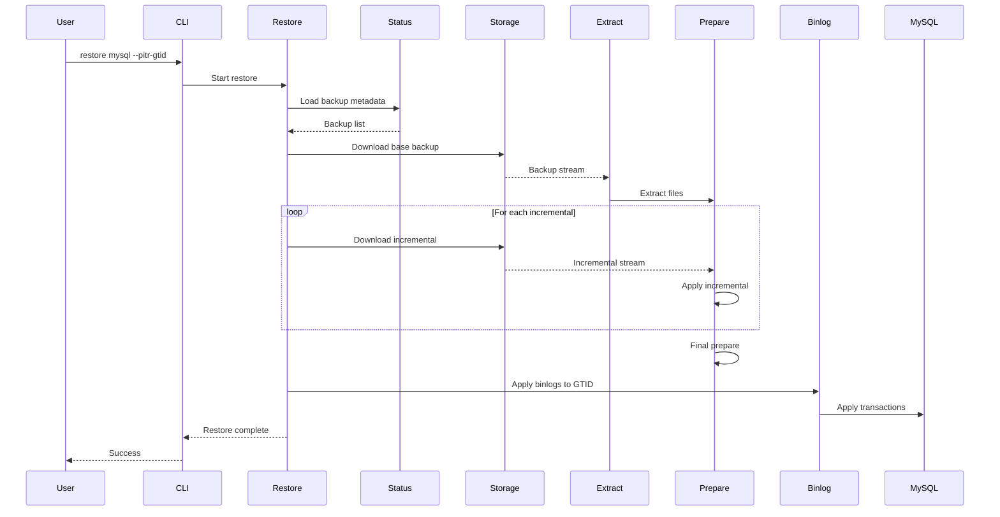
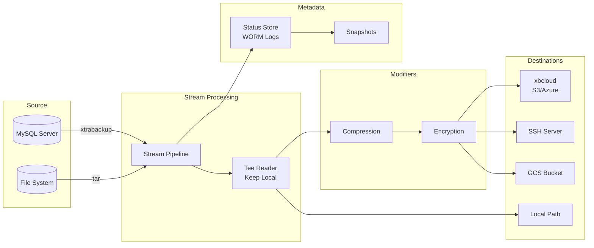
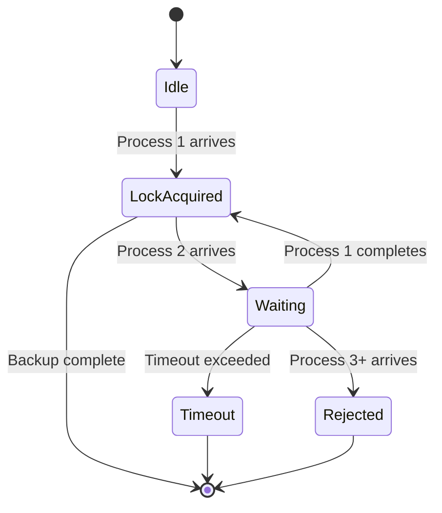
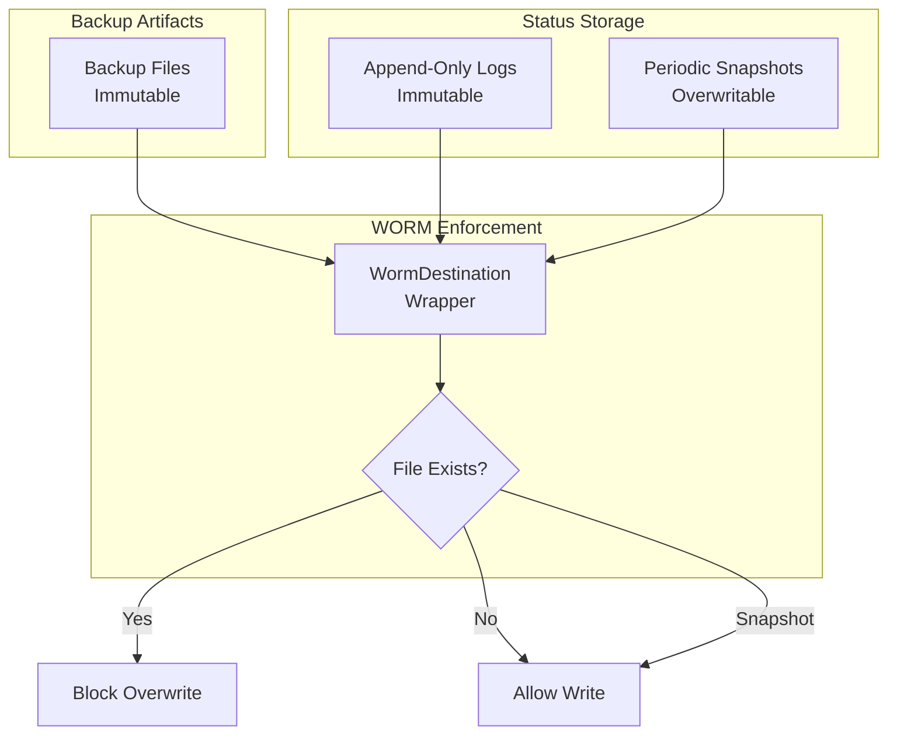

# Architecture

## Overview

TwinDB Backup v5.0.0 is a streaming backup system that processes data through a pipeline of sources, modifiers, and destinations. The architecture is designed for high performance, reliability, and compliance with security standards.

## Components

- `cmd/twindb-backup`: CLI entrypoint using Cobra
- `internal/config`: YAML configuration parser and validator
- `internal/logging`: structured logging with JSON file output
- `internal/metrics`: statsd/datadog metrics emitters
- `internal/pipeline`: backup pipeline orchestrator (sources → modifiers → destinations)
- `internal/destination`: pluggable storage backends (xbcloud, ssh, gcs, local)
- `internal/status`: status metadata storage with WORM append-only logs
- `internal/restore`: restore and PITR (Point-in-Time Recovery) logic
- `internal/verify`: backup integrity verification
- `internal/lock`: file-based locking with queue support (one active, one waiting, rest rejected)
- `internal/mysql`: MySQL client and configuration discovery
- `internal/crypto`: GPG encryption/decryption support

## System Architecture Diagram

## Backup Flow

## Restore Flow (PITR)

## Data Flow Architecture

## Lock Mechanism

The lock system prevents concurrent backup runs and resource waste:

## WORM Storage Architecture

## Component Details

### Pipeline (`internal/pipeline`)

The pipeline orchestrates the backup process:

1. **Lock Acquisition**: Prevents concurrent runs
2. **Source Selection**: MySQL (xtrabackup) or files (tar)
3. **Stream Processing**: Pipes data through modifiers
4. **Modifiers**: Compression (gzip/bzip2) and encryption (GPG)
5. **Destination Upload**: Streams to remote storage
6. **Status Update**: Records metadata in WORM logs
7. **Retention**: Applies retention policies (if WORM disabled)

### Status Store (`internal/status`)

Manages backup metadata with WORM semantics:

- **Append-Only Logs**: Immutable event log for each backup
- **Snapshots**: Periodic summaries for fast loading
- **Checksums**: SHA-256 verification for integrity
- **GTID Tracking**: Enables PITR recovery

### Destination Interface (`internal/destination`)

Pluggable storage backends:

- **xbcloud**: S3/Azure via Percona's xbcloud tool
- **ssh**: Remote server via SSH/SCP
- **gcs**: Google Cloud Storage via gsutil
- **local**: Local filesystem
- **WORM Wrapper**: Enforces immutability

### Restore Engine (`internal/restore`)

Handles full restore and PITR:

1. **Backup Selection**: Finds base + incrementals
2. **Extraction**: Downloads and extracts backups
3. **Incremental Apply**: Applies incrementals in order
4. **Final Prepare**: Runs `xtrabackup --prepare`
5. **PITR**: Applies binlogs to GTID or timestamp
6. **Config Restore**: Restores MySQL config files
