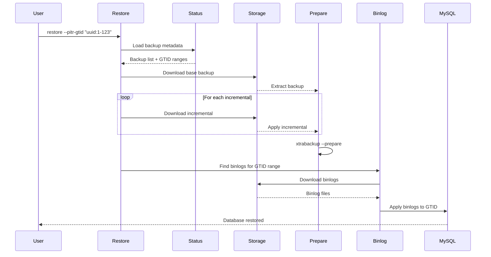

# PITR Restore

Point-in-Time Recovery (PITR) allows you to restore a MySQL database to a specific point in time using binary logs. This is essential for recovering from data corruption, accidental deletions, or other point-in-time issues.

## How PITR Works

PITR combines:
1. **Base backup**: Full backup (or full + incrementals)
2. **Binary logs**: Transaction logs captured after the backup
3. **GTID or timestamp**: Target point for recovery

The restore process:
1. Restores the base backup
2. Applies incrementals (if any)
3. Prepares the backup with `xtrabackup --prepare`
4. Applies binary logs up to the target GTID or timestamp

## PITR Workflow Diagram



## Prerequisites

1. **Base backup exists**: Full backup (or full + incrementals) before target time
2. **Binary logs available**: Binlogs captured from backup time to target time
3. **GTID enabled**: For GTID-based recovery (recommended)
4. **Binlog format**: ROW format recommended for best compatibility

## GTID-Based Recovery

GTID (Global Transaction Identifier) provides precise transaction tracking.

### Example

```sh
# Restore to specific GTID
twindb-backup restore mysql \
  --to-dir /restore \
  --pitr-gtid "3E11FA47-71CA-11E1-9E33-C80AA9429562:1-12345"
```

### Finding the Target GTID

1. **From application logs:**
   - Check application error logs for GTID before corruption
   - Use transaction timestamps

2. **From MySQL:**
   ```sql
   -- Check current GTID
   SHOW MASTER STATUS;
   
   -- Check GTID executed
   SELECT @@GLOBAL.gtid_executed;
   ```

3. **From backup status:**
   ```sh
   twindb-backup status --type mysql
   # Look for GTID in backup metadata
   ```

## Time-Based Recovery

Time-based recovery uses timestamps to find the recovery point.

### Example

```sh
# Restore to specific timestamp
twindb-backup restore mysql \
  --to-dir /restore \
  --pitr-time "2025-01-15 14:30:00"
```

### Timestamp Format

- Format: `"YYYY-MM-DD HH:MM:SS"`
- Timezone: Uses system timezone
- Precision: Second-level precision

### Finding the Target Time

1. **From application logs:**
   - Check error logs for timestamp before issue
   - Use application transaction timestamps

2. **From backup metadata:**
   ```sh
   twindb-backup summary
   # Shows finished time for each backup
   ```

## Restore Process

### Step-by-Step

1. **List available backups:**
   ```sh
   twindb-backup ls --type mysql
   ```

2. **Verify backup integrity:**
   ```sh
   twindb-backup verify mysql "mysql-2025-01-15_00_00_00.xbstream.gz"
   ```

3. **Restore with PITR:**
   ```sh
   twindb-backup restore mysql \
     --to-dir /restore \
     --pitr-gtid "uuid:1-12345"
   ```

4. **Verify restored data:**
   ```sh
   # Check MySQL data directory
   ls -lh /restore/
   
   # Verify GTID
   cat /restore/xtrabackup_binlog_info
   ```

5. **Start MySQL with restored data:**
   ```sh
   # Copy to MySQL data directory
   sudo systemctl stop mysql
   sudo rm -rf /var/lib/mysql/*
   sudo cp -r /restore/* /var/lib/mysql/
   sudo chown -R mysql:mysql /var/lib/mysql
   sudo systemctl start mysql
   ```

## Binlog Requirements

### Binlog Backup

Ensure binlogs are being backed up:

```yaml
backup:
  intervals:
    hourly: true  # For frequent binlog backups
```

Run binlog-only backups:

```sh
twindb-backup backup hourly --binlogs-only
```

### Binlog Retention

Configure binlog retention:

```yaml
mysql:
  expire_log_days: 7  # Keep binlogs for 7 days
```

**Important:** `expire_log_days` must cover the time between base backup and PITR target.

### Binlog Format

Recommended settings:

```ini
[mysqld]
binlog_format=ROW
binlog_row_image=FULL
gtid_mode=ON
enforce_gtid_consistency=ON
```

## Examples

### Scenario 1: Accidental DELETE

**Problem:** Accidental `DELETE FROM users WHERE id = 123` at 14:30:00.

**Solution:**
```sh
# Restore to just before the DELETE
twindb-backup restore mysql \
  --to-dir /restore \
  --pitr-time "2025-01-15 14:29:59"
```

### Scenario 2: Data Corruption

**Problem:** Database corruption detected, last known good GTID: `uuid:1-50000`.

**Solution:**
```sh
# Restore to last known good GTID
twindb-backup restore mysql \
  --to-dir /restore \
  --pitr-gtid "uuid:1-50000"
```

### Scenario 3: Point-in-Time Audit

**Problem:** Need to see database state at specific time for audit.

**Solution:**
```sh
# Restore to audit time
twindb-backup restore mysql \
  --to-dir /restore \
  --pitr-time "2025-01-15 12:00:00"

# Query restored data
mysql --socket=/restore/mysql.sock -e "SELECT * FROM audit_table"
```

## Limitations

1. **Binlog availability**: PITR requires binlogs from backup time to target time
2. **Binlog expiration**: Expired binlogs cannot be used for PITR
3. **GTID gaps**: Missing GTIDs may cause incomplete recovery
4. **Time precision**: Time-based recovery has second-level precision
5. **DDL changes**: Some DDL changes may affect binlog application

## Best Practices

1. **Frequent binlog backups:**
   - Run hourly binlog-only backups
   - Ensure binlogs are captured before expiration

2. **Test PITR regularly:**
   - Monthly PITR tests
   - Verify recovery procedures
   - Document recovery times

3. **Monitor binlog retention:**
   - Ensure `expire_log_days` covers recovery window
   - Monitor binlog backup success
   - Alert on binlog backup failures

4. **Use GTID when possible:**
   - More precise than timestamps
   - Better for replication
   - Easier to track transactions

5. **Document recovery procedures:**
   - Keep runbook for PITR
   - Document common scenarios
   - Practice disaster recovery
